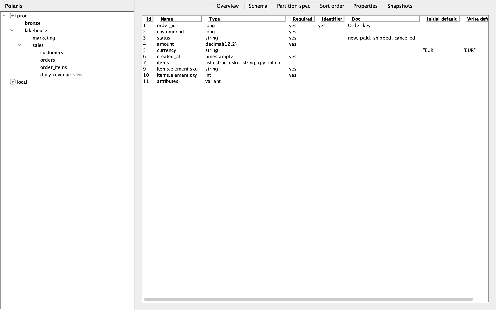
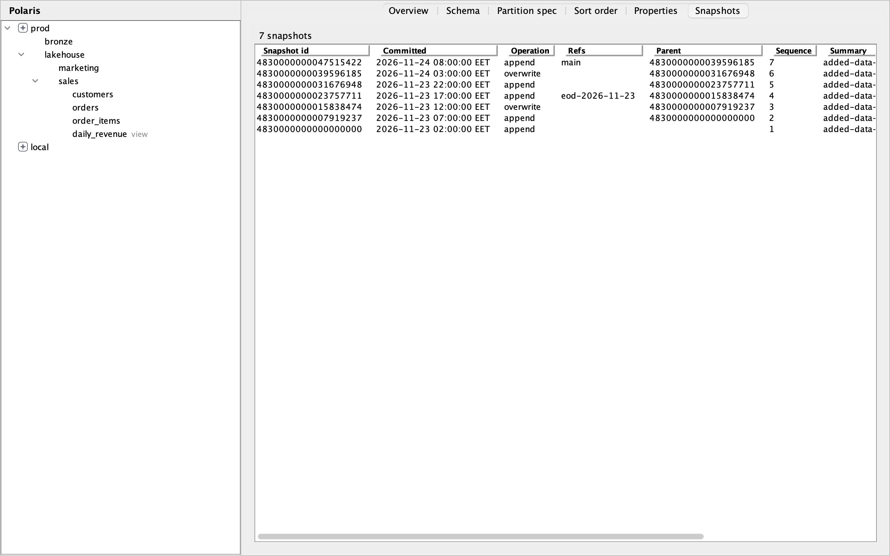
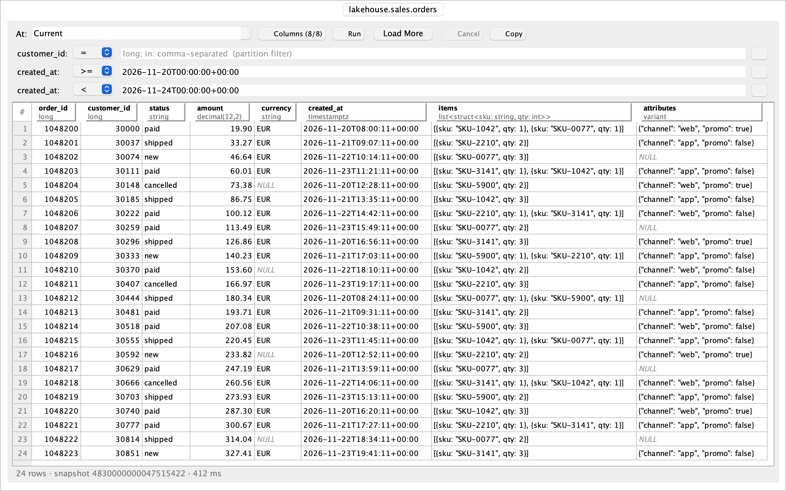
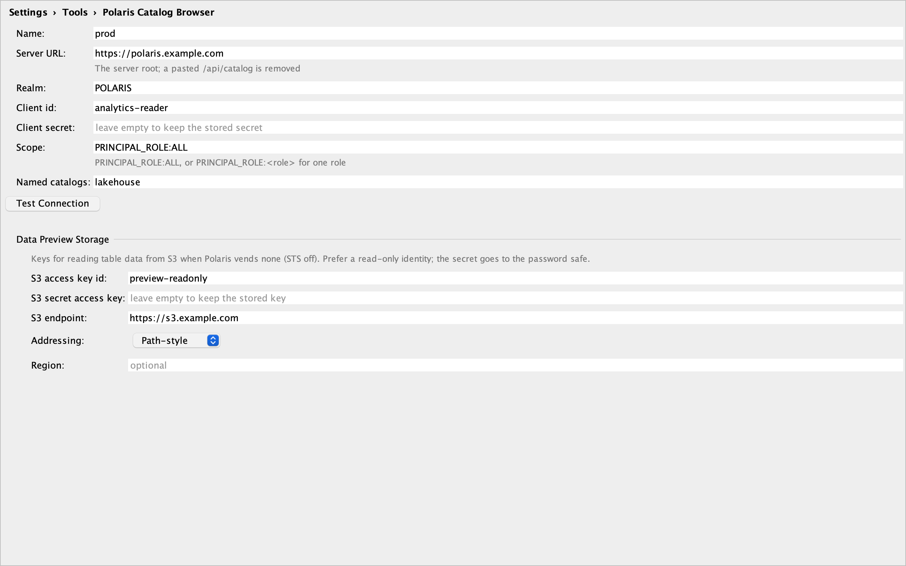

# Catalog Browser for Apache Polaris

[English](README.md)

Плагин для PyCharm, чтобы смотреть каталоги Apache Polaris прямо из IDE: каталоги,
вложенные namespace, таблицы Iceberg и view. Для таблицы он показывает схему,
партиционирование, сортировку, свойства, историю снапшотов и сами строки.

Плагин **только читает**: он ничего не создаёт, не меняет и не удаляет ни в
Polaris, ни в S3.

[JetBrains Marketplace](https://plugins.jetbrains.com/plugin/36438-catalog-browser-for-apache-polaris)

- [Скриншоты](#скриншоты)
- [Установка](#установка)
- [Подключение к Polaris](#подключение-к-polaris)
- [Дерево каталогов](#дерево-каталогов)
- [Карточка таблицы и view](#карточка-таблицы-и-view)
- [Данные таблицы: вкладка Data](#данные-таблицы-вкладка-data)
- [Безопасность](#безопасность)
- [Если что-то не работает](#если-что-то-не-работает)
- [Ограничения](#ограничения)

## Скриншоты

Дерево каталогов и схема таблицы:



История снапшотов с ветками и тегами:



Данные таблицы во вкладке редактора с фильтром по колонке партиционирования:



Подключение с ключами S3 для превью данных:



## Установка

Нужен PyCharm **2026.2 или 2026.3**. Подходит и любая другая IDE JetBrains тех
же версий.

**Из файла.** Так ставим, пока нет внутреннего репозитория плагинов.

1. Возьмите файл `polaris-catalog-browser-<версия>.zip`.
2. **Settings → Plugins → ⚙ → Install Plugin from Disk…** и выберите этот zip.
3. Перезапустите PyCharm, если он попросит.

Новые версии ставятся так же, поверх старой.

**Из репозитория плагинов**, когда он появится.

1. **Settings → Plugins → ⚙ → Manage Plugin Repositories…** и добавьте URL
   файла `updatePlugins.xml`.
2. На вкладке **Marketplace** найдите «Polaris Catalog Browser» и установите.
   Обновления PyCharm будет предлагать сам.

## Подключение к Polaris

**Settings → Tools → Polaris Catalog Browser**, затем **+**.

| Поле | Что вписать |
| --- | --- |
| Name | Любое имя, например `prod` |
| Server URL | Адрес Polaris, например `https://polaris.example.com`. Можно вставить и с `/api/catalog`, хвост уберётся сам |
| Realm | Realm Polaris, если их несколько. Иначе оставьте пустым |
| Client id / Client secret | Учётные данные principal'а Polaris |
| Scope | `PRINCIPAL_ROLE:ALL`. Если нужна одна роль, `PRINCIPAL_ROLE:<роль>` |
| Named catalogs | Каталоги через запятую, если principal'у нельзя получать их список (см. ниже) |

Нажмите **Test Connection**. При успехе появится «Connected: a token was
issued». Затем **OK**.

Подключений может быть несколько, например dev, test и prod. Каждое
появится в дереве отдельным узлом.

Ключи S3 в блоке **Data Preview Storage** нужны только для просмотра строк, о
них [ниже](#данные-таблицы-вкладка-data).

## Дерево каталогов

Откройте окно **Polaris** на правой панели PyCharm: значок со звездой в рамке.

```text
prod                       ← подключение
└── bronze                 ← каталог
    └── sales              ← namespace (могут быть вложенными)
        ├── events         ← таблица
        └── recent  view   ← view
```

- Узлы раскрываются по клику, содержимое загружается при первом раскрытии.
- **Двойной клик или Enter по таблице** открывает её данные в отдельной вкладке
  редактора, как файл в Big Data Tools. Повторный двойной клик переключает на
  уже открытую вкладку.
- **Поиск.** Просто начните печатать, когда дерево в фокусе. Ищет только среди
  уже раскрытых узлов.
- Кнопки на панели инструментов:

| Кнопка | Что делает |
| --- | --- |
| ⟳ Refresh | Перечитывает выбранный узел, или всё дерево, если ничего не выбрано |
| Open Data Preview | Открывает данные выбранной таблицы во вкладке редактора (то же, что двойной клик) |
| + Add Catalog by Name | Добавляет каталог по имени к выбранному подключению |
| Copy Qualified Name | Копирует `каталог.namespace.таблица` в виде для Spark SQL: части с `-` и другими символами берутся в обратные кавычки |
| ⚙ Settings | Открывает настройки подключений |

**«Not permitted to list catalogs».** Principal'у не дали права видеть список
каталогов. Выберите подключение, нажмите **Add Catalog by Name** и введите имя
каталога, например `bronze`. Дальше всё работает как обычно. Каталог
запоминается в поле *Named catalogs*.

**«Client secret not stored: double-click to enter it».** Секрет Polaris не
сохранился, например если хранилище паролей IDE настроено «не запоминать».
Дважды кликните по сообщению и введите секрет.

## Карточка таблицы и view

Выберите таблицу. Внизу откроется карточка с вкладками:

| Вкладка | Что там |
| --- | --- |
| Overview | Где лежат метаданные и данные, версия формата (v1–v3), UUID, текущий снапшот, время последнего изменения |
| Schema | Колонки: id, имя, тип, required, ключ, описание, значения по умолчанию. Вложенные поля показаны полным путём, например `attrs.value.v` |
| Partition spec | Поля партиционирования: трансформ (`day`, `bucket[16]`, …) и колонка-источник |
| Sort order | Порядок сортировки при записи |
| Properties | Свойства таблицы. Значения ключей, похожих на секреты (secret, password, token, access key, credential, ключи шифрования, shared и private key, connection string, SAS), скрыты: `********` |
| Snapshots | История снапшотов, новые сверху: время, операция, ветки и теги, summary |
| Data | Строки таблицы, см. ниже |

Сначала загружаются только снапшоты, на которые указывают ветки и теги, так
быстрее. Полная история подгружается, когда вы откроете вкладку **Snapshots**.

Для **view** вкладки такие: Overview, Schema, SQL (отдельная вкладка на каждый
диалект, например Spark и Trino) и Properties. Данных у view нет.

**⟳ Refresh** на выбранной таблице проверяет, не изменилась ли она. Если не
изменилась, перезагрузки не будет.

## Данные таблицы: вкладка Data

Плагин читает **таблицу**, а не отдельные Parquet-файлы, и применяет
удаления (deletion vectors, position и equality deletes). Поэтому строки,
удалённые или перезаписанные при CDC-merge, не появятся. Вы увидите то же,
что вернёт `SELECT` в Spark.

### Один раз: ключи S3

Если в каталоге Polaris выключен STS (`stsUnavailable`), Polaris не выдаёт
временные ключи к хранилищу. Тогда их нужно ввести в подключении, в блоке
**Data Preview Storage**:

| Поле | Что вписать |
| --- | --- |
| S3 access key id | Ключ S3 (AWS, MinIO, SeaweedFS и т. п.). **Лучше только на чтение** |
| S3 secret access key | Секрет ключа. Хранится в Keychain, в файлы настроек не попадает |
| S3 endpoint | Адрес S3. Если пусто, берётся тот, что сообщает Polaris |
| Addressing | *From Polaris* (по умолчанию), *Path-style* или *Virtual-host*. MinIO и SeaweedFS часто требуют *Path-style* |
| Region | Обычно не нужен |

Пустой ключ означает, что плагин попросит у Polaris временные ключи (vended
credentials); для этого у principal'а должен быть грант `TABLE_READ_DATA`.

### Как смотреть

Данные открываются двумя способами, вид и кнопки у них одинаковые:

- **во вкладке редактора**: двойной клик или Enter по таблице в дереве. Можно
  держать открытыми несколько таблиц и переключаться между ними. Вкладки не
  восстанавливаются после перезапуска PyCharm;
- **во вкладке Data** карточки таблицы под деревом, чтобы быстро глянуть.

Первые 100 строк загрузятся сами.

| Элемент | Что делает |
| --- | --- |
| **At** | Состояние таблицы: *Current*, ветка или тег (`main`, `before-merge`), снапшот из истории, или впишите id снапшота вручную |
| **Columns (N/M)** | Какие колонки читать. Флажок **All** сверху отмечает или снимает все сразу. Чем меньше колонок, тем быстрее. Если выбраны все, старый снапшот покажет колонки своей схемы |
| Строки фильтра | По строке на каждую колонку, по которой партиционирована таблица: оператор (`=`, `!=`, `<`, `<=`, `>`, `>=`, `in`) и значение. Пустое значение значит без фильтра. **+** добавляет ещё одно условие на ту же колонку, например для диапазона |
| **Run** | Прочитать заново с текущими настройками |
| **Load More** | Ещё 100 строк, всего до 1000 |
| **Cancel** | Остановить чтение |
| **Copy** | Скопировать выделенные строки, или все, с заголовком, через табуляцию. Вставляется в Excel или Google Sheets |

Как вводить значения фильтра:

- дата: `2026-11-02`;
- время: `2026-11-02T00:00:00`;
- для `in`: значения через запятую, например `a, b, c`.

Фильтр по колонке партиционирования отсекает лишние файлы ещё до чтения.
Например, два условия на `ts`, `>= 2026-11-02T00:00:00` и
`< 2026-11-03T00:00:00` (второе добавляется кнопкой **+**), читают только
файлы за 2 ноября.

Колонка, добавленная в таблицу после последней записи, видна на *Current* и
на ветках со значением `NULL`. Тег или старый снапшот читаются со своей
схемой, как в Spark.

Таблица с данными устроена как в Big Data Tools: слева номера строк, в
заголовке имя колонки и под ним её тип, линии сетки, ширина колонок
подбирается по содержимому (очень длинные значения обрезаются, ширину можно
поменять мышью), числа выровнены вправо. Можно выделять отдельные ячейки и
диапазоны, Ctrl+C копирует выделенное.

Строка статуса внизу показывает, сколько строк прочитано, какой снапшот
читался и сколько это заняло. `NULL` выделен серым курсивом, чтобы не путать
его со строкой `"null"`.

Если у подключения задан ключ S3, но его секрет не сохранён, вкладка покажет
кнопку **Enter S3 Secret…**. Секрет можно сохранить в хранилище паролей или
держать только до закрытия IDE.

## Безопасность

- Секрет Polaris и секрет S3 хранятся только в хранилище паролей IDE (на macOS
  это Keychain). В файлах настроек, логах и сообщениях об ошибках их нет.
- Строки таблиц не сохраняются на диск, а ключи S3 держатся в памяти только
  пока открыт просмотр одной таблицы.
- Кто может читать данные, решает ключ S3: всё, что ему разрешено в хранилище,
  видно и в плагине. Не используйте в плагине ключи с правом записи.

## Если что-то не работает

| Сообщение | Что делать |
| --- | --- |
| `token request refused: invalid_client` | Неверный client id или секрет. Проверьте их в настройках |
| `Not permitted to list catalogs` | Это не ошибка: добавьте каталог через **Add Catalog by Name** |
| `… 403 …` при раскрытии namespace | У principal'а нет прав на этот namespace или таблицу. Обратитесь к администратору Polaris |
| `Polaris vended no storage credentials … Enter S3 keys` | Заполните **Data Preview Storage** в подключении |
| `S3 refused access (403)` | Ключ S3 не имеет доступа к бакету таблицы. Нужен другой ключ или права |
| `S3: … NoSuchBucket` / ошибки адреса | Проверьте **S3 endpoint** и **Addressing** (попробуйте *Virtual-host* или *Path-style*) |
| `The preview reads tables on S3 only` | Таблица лежит не в S3 (локальная файловая система, GCS, Azure): превью для неё не поддерживается |
| `TLS failed …` во вкладке Data | S3 или Polaris за внутренним сертификатом: его нужно добавить в JDK, на котором работает PyCharm. Обратитесь к тому, кто ставил вам PyCharm |
| TLS-ошибка в дереве | Примите сертификат в **Settings → Tools → Server Certificates** |
| `no longer exists` | Таблицу удалили или переименовали: нажмите **Refresh** на её namespace |
| Дерево не обновилось | Выберите узел и нажмите **⟳ Refresh** |

## Ограничения

- Только чтение: создать, изменить или удалить что-либо нельзя.
- Не больше 1000 строк, без SQL и сортировки. Для этого есть Spark или Trino.
- Фильтр только по колонкам партиционирования.
- Не показываются principal'ы, роли и гранты.
- Поиск только по уже раскрытым узлам дерева.

Разработка и сборка: [DEVELOPMENT.md](DEVELOPMENT.md). Лицензия: Apache License 2.0
([LICENSE](LICENSE)); сторонние библиотеки: [THIRD-PARTY.md](THIRD-PARTY.md).

Apache Polaris — товарный знак Apache Software Foundation. Плагин не связан с
ASF и не одобрен ею; иконка плагина своя и не использует логотип Apache Polaris.
